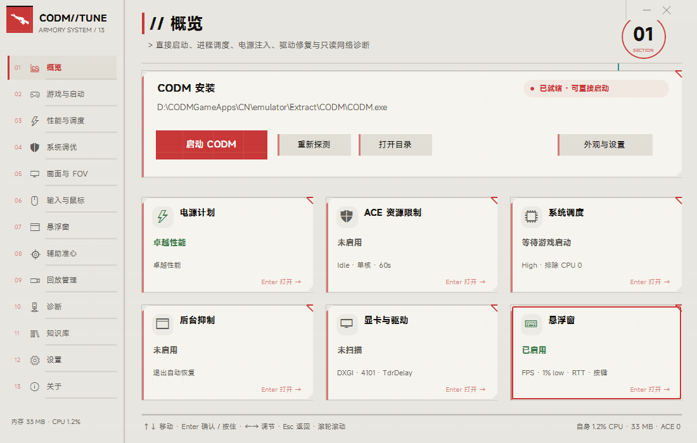
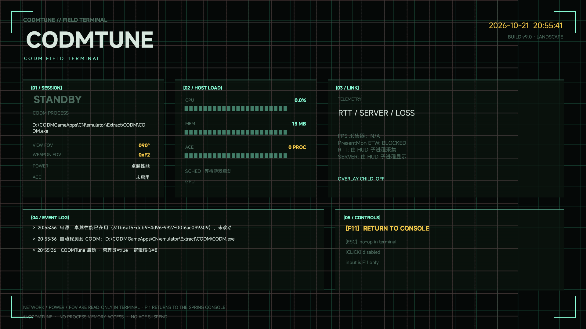
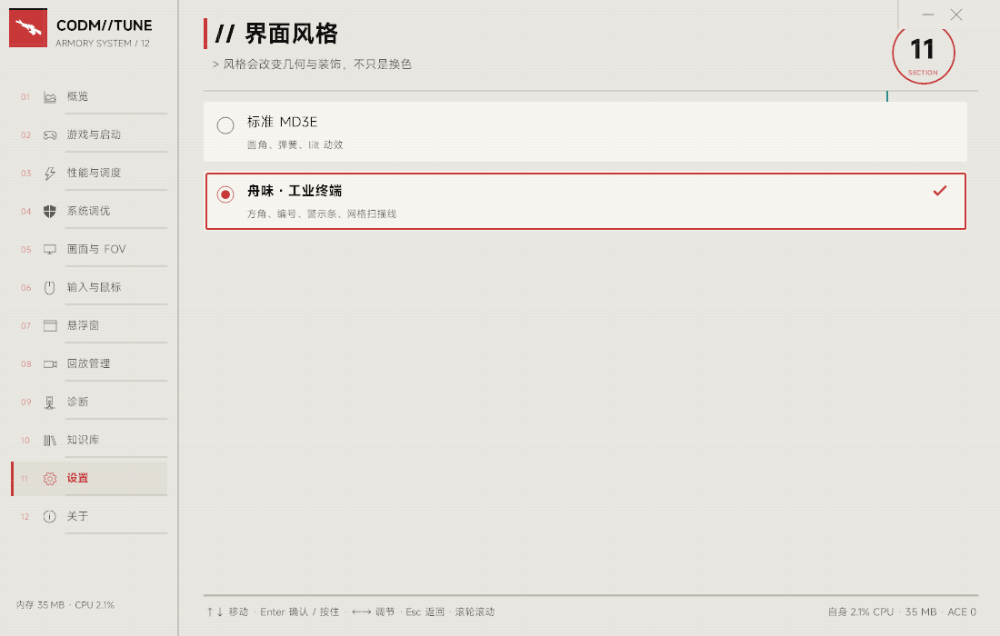
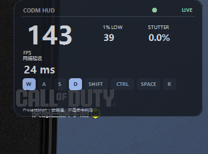
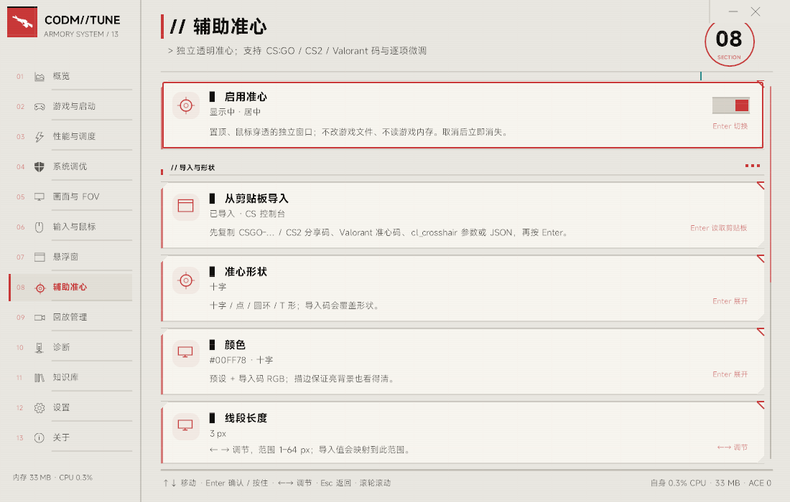
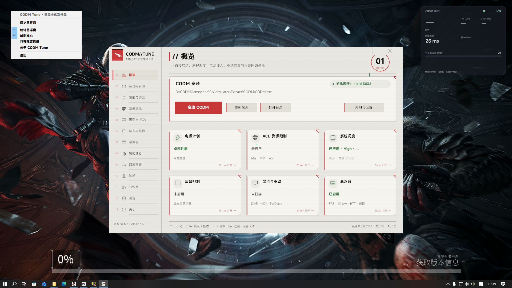

# CODM TUNE

> v11：HUD 改为只采集真实数据；PresentMon 增加 `--no_track_display/gpu/input` 过滤器后，本机已能稳定拿到真实 FPS 与 1% low（实测 95 FPS / 1% low 30 / 卡顿 0.4%）；托盘加入声音、显示/悬浮窗/准心菜单；新增「辅助准心」独立子进程，支持 CSGO/CS2/Valorant/控制台/JSON 码导入与逐项调节；首次启动三页 OOBE；游戏检测过滤本工具自身 PID。

给《使命召唤手游》高清模拟器用的原生 Windows 性能与体验工具。Win32 + GDI+，不注入、不挂钩游戏进程；系统改动保存原值并可还原。



## v11 的关键变化

- **HUD 不再伪造数据**：FPS/1% low/卡顿只在 PresentMon 采到真实样本时显示，采不到为 `—`；RTT 先 ICMP、失败再 TCP，失败保持 `—`；吞子弹估算已从 HUD 与设置中移除，避免把推测当命中判定。
- **FPS 采集（本机已验证）**：PresentMon 2.6 的默认 display/GPU/input 跟踪会丢数万 ETW 事件；现固定使用 `--no_track_display --no_track_gpu --no_track_input --set_circular_buffer_size 262144 --output_stdout`，输出写入 `live.csv` 后按 UTF-16LE 解码。统计只取最近 2 秒/240 帧的连续样本，避免把菜单、加载和长时间停顿混进平均帧；FPS 与 1% low 来自同一窗口，不会再出现“平均 15 / 1% low 58”这种不可能值。CODM 训练场实测 95–165 FPS、1% low 30–53、卡顿 0–0.6%、RTT 24ms。
- **准心码导入**：支持 `CSGO-xxxxx`（CSGO 57 进制）、CS2 分享码（46 字符）、Valorant 分号码、`cl_crosshair*` 控制台参数、JSON；导入后映射到本工具的形状/长度/线宽/间隙/颜色/点/描边/透明度/偏移。
- **三页 OOBE**：首次启动显示安全边界、轻量架构、桌面闭环；Enter 继续，Esc 跳过，完成状态写回配置。
- **托盘**：进托盘播放下沉提示音；菜单含显示窗口、悬浮窗开关、准心开关、配置目录、关于、退出；重复启动会唤起窗口并提示。
- **游戏检测**：跳过本工具自身 PID/路径，避免把主程序或 HUD/准心子进程误判成 CODM。
- **13 个分类**：新增「辅助准心」与「关于」，原有 11 个分类保留。

## v11 的关键变化

- **图标换稿**：纸灰圆角底 + 黑色 KRM262 剪影 + 右上红色切角；桌面快捷方式使用独立文件名验证，避免 Explorer 继续拿旧缓存。
- **舟味切页更快更稳**：0.78 s，ease-out cubic 曲线；过渡期间只绘制新页并切边，不再每帧重绘旧页，因此不再卡顿也不会出现两页文字叠影。
- **软件内图标回退**：导航恢复 MD3E 图标集，只保留 exe/窗口 logo 的游戏剪影。
- **重复启动提醒**：托盘已有实例时，隐藏窗口直接唤起；窗口本来可见时弹出一条顶层提示，不再“点了没反应”。
- **关于页收敛**：移除无关项目推广，改为作者、AI 协作、界面参考三段；不改变任何安全边界。
- **DPI 文本**：GDI+ 文本改为 `ClearTypeGridFit` + `PixelOffsetModeHalf`；在 100%/125%/150% 下优先保证笔画清晰，若目标 surface 不支持 ClearType 会自动退回灰度抗锯齿。

- **默认进入舟味 · 工业终端**。标准 MD3E 仍可在「设置 → 界面风格」切换。
- **舟味支持浅色纸灰与深色墨黑**两套；主题、强调色、圆角、字体、背景仍全部可调。
- **强调色不再被舟味吞掉**：蓝 / 薄荷 / 琥珀 / 紫 / 红全部生效；也支持壁纸取色与 `#RRGGBB` 自定义。
- **高级模式有独立视觉**：危险色主色、顶部 hazard band、填充式章节徽章、卡片红色警示块，切换时播放 `HazardFlash()` 扫描动画。
- **切页动画**：
  - 舟味：0.78 s ease-out cubic 斜切揭开，只绘制新页，旧页在开始时即退出；终端/F11 改为只保留新页 + 自己的从左到右 CLI 揭幕，避免旧页被放大。
  - 标准 MD3E：新页只做 14 px 短弹簧落位，不滑动旧页、不露背景缝。
- **选择框对齐**：清除 anticipatory lean，`Settle()` 清零位移，描边内缩 1.5 px；连续移动不累积偏移。
- **方向键不越区**：内容区 Up/Down 只在内容区找目标；从第一行继续按 Up 不会跳到侧栏。
- **单实例与托盘**：已有实例时再次启动会 `SW_SHOW`/`SW_RESTORE` 并 `WM_APP_SHOW` 唤起窗口；若窗口本来可见，再弹一条“已经在运行”的顶层提示。
- **扫描异步化**：显卡/网络扫描在后台执行，行内显示“扫描中 xx%”，完成后原地重绘，不需要退出页面再进。
- **HUD 自定义**：样式紧凑/完整、四角位置 + 自定义 X/Y（10px 步进）、HUD 不透明度 70–100%（`← →` 约 4%/次；点击/拖动滑轨直接定位；不再有显示值与实际 alpha 的 +20 偏移）、纯文字模式；1% low / 卡顿 / FPS / 按键 / 网络/省份可分别开关；吞子弹估算已停用。滑轨焦点按 ←/→ 松开后不会把焦点甩回侧栏。
- **图标**：exe 使用纸灰底 + 黑色 KRM262 + 红色切角；软件内导航使用 MD3E 图标集，避免“全应用都是枪”的视觉疲劳。
- **13 个分类**，新增「辅助准心」与「关于」：版本、设计目标、安全边界、作者、AI 协作与界面参考；不再推广无关项目。
- **图标完整尺寸**：16/20/24/32/40/48/64/96/128/256 十档写入 ICO，`build.cmd` 每次重生成 `rsrc.syso`。
- **四类独立音效**：软件启动、选择（焦点移动）、确认（执行/切换）、游戏启动；可分别关闭，音量共用一个总音量。
- **空闲 CPU**：网格/扫描线预渲染为透明图层；主进程空闲约 0.31% / 32 MB。







## 安全边界

- 不对 CODM / ACE 做 `WriteProcessMemory`、`CreateRemoteThread`、`SetWindowsHookEx`、DLL 注入；不结束、不挂起 ACE。
- 不修改游戏目录文件，不读写游戏内存。
- 注册表仅写 `HKCU\SOFTWARE\Tencent\Call-of-Duty` 与显式系统项；写前保存原值，可还原。
- HKLM 项（TdrDelay / HAGS / 优先级）仅高级模式可见，写前快照。
- HUD 按键用 `GetAsyncKeyState` 轮询，不装键盘钩子。
- 省份查询默认开启；只把当前对局服务器 IP 发往 `ip-api.com`，可在设置关闭。
- 回放只复制/打开，不删除原文件。

## 分类

| 分类 | 内容 |
|---|---|
| 概览 | 安装路径、启动、重新探测、状态卡、功能过多提示 |
| 游戏与启动 | 直接启动、安装探测、启动器回退、战绩官方入口 |
| 性能与调度 | 卓越性能（保留熄屏/休眠）、ACE 限制、后台抑制、系统调度、0.5 ms 计时器 |
| 系统调优 | 游戏模式、GameDVR、GPU 偏好；高级：极简外观、优先级、HAGS、全屏优化 |
| 画面与 FOV | 持枪 FOV 字节解锁、视野只读说明、帧率无上限、按住写入/还原 |
| 输入与鼠标 | 鼠标加速、视角启动参数、D3D11、灵敏度快照/还原 |
| 悬浮窗 | 开关、常驻、二级样式/位置（含自定义 X/Y）、透明度滑块、FPS/1% low/卡顿/按键/纯文字 |
| 回放管理 | 扫描回放、备份、定位 |
| 诊断 | DXGI/实际 GPU、4101、TdrDelay、运行库、DNS/TCP；扫描异步显示进度，结果原地刷新 |
| 知识库 | `knowledge/*.md` 列表与阅读 |
| 设置 | 风格、强调色/壁纸取色、主题、字体、全屏、圆角、背景、四类音效、高级 |
| 关于 | 版本、设计目标、安全边界、作者、AI 协作、界面参考；不含无关项目推广 |

## 舟味风格（参考 BV1wEcqzfE3D / BV1TFs4zvEB5）

- 侧栏：`01..12` 编号、方角选中条、`CODM//TUNE`、`ARMORY SYSTEM / 12`。
- 卡片：纸白/墨黑面、左侧主色条、左上/右下斜切角、细网格/扫描线。
- 按钮/开关：方角高对比；强调色与主色联动。
- 标题：`// 概览`、`> 副标题`、大号 `01/SECTION` 圆环与半调点。
- 深浅两套共享几何；切页是一道主色斜切扫过，0.78 s ease-out，只保留新页，而不是整屏推入。
- 只使用风格语言，不使用《明日方舟》的任何美术素材或字体。
- 设计分析：[明日方舟美术解析 Part.1](https://www.bilibili.com/video/BV1wEcqzfE3D)；转场参考：[促融共竞#2 UI 转场纯享版](https://www.bilibili.com/video/BV1TFs4zvEB5)。

## 强调色与高级模式

- 预设：蓝 / 薄荷 / 琥珀 / 紫 / 红。
- **从壁纸取色**：读取 `HKCU\Control Panel\Desktop\Wallpaper`，失败时回退 `TranscodedWallpaper`；按中间调、饱和度筛选后取平均，生成可读色。只读图片，不改壁纸。
- **自定义**：配置里的 `accent_hex` 支持 `#RRGGBB`。
- 标准与舟味、浅色与深色都应用同一套强调色。
- 高级模式强制危险红，并额外绘制 hazard band、填色 SECTION 徽章、卡片警示块；关闭后恢复用户选择的强调色。

## 焦点与动效

- 焦点环由四条独立弹簧边驱动；按键按下时向移动方向轻微前倾，释放时通过 `Settle()` 清零，再落到目标矩形。
- 内容区的 Up/Down 通过 `findFocusWhere` 排除 `nav:` 节点；侧栏 Down 只进入侧栏，不会在内容里乱跳。
- 弹簧时间步固定，页面切换与焦点移动都不使用固定时长动画。
- 舟味背景网格/扫描线来自 `ensureArkGrid` 生成的透明 PNG，主循环只做一次 `DrawImage`。

## F11 横屏 / FIELD TERMINAL

- F11 进入 1920×1080 无边框终端，F11 返回原页面。
- 终端内容：会话、主机负载、链路、事件日志、控制提示、时钟。
- 进入时先切到纸色底，再从左向右揭开终端（约 0.72 s），不再把旧 1100×700 页面放大到 1080p。
- 终端是进入时绘制一次的只读快照；不参与主界面命中测试，因此不会出现“显示与输入错位”。
- 普通全屏/恢复的 viewport 变换已重置，鼠标反算与画面使用同一 scale/offset。

## FOV 数据格式（v6 更正，v8 保持）

- 视野/持枪键都是 **8 字节 REG_DWORD payload**；旧版 v3 把整段写成 float64 是**错误**的。
- 社区验证过的做法（[CODM-Tactix-Hub](https://github.com/DreamChaserWhatever/CODM-Tactix-Hub)）：只改 **byte 6**，默认 `0xF2`，最大 `0xFF`，其余 7 字节保持原样。
- 本机实测：`...66 66 F2 3F → ...66 66 FF 3F → 还原 F2`，长度始终 8，byte 0..5/7 不变。
- **视野键不再写**：请用游戏内 FOV 滑块。工具只解锁持枪 FOV 的 byte 6，避免破坏 payload。
- 恢复：游戏内拖动 FOV 滑块，或使用工具写入前的整键 `.reg` 备份。

## 电源

- 注入前读取当前方案的 `VIDEOIDLE`、`STANDBYIDLE`、`HIBERNATEIDLE` 的 AC/DC 值；切换后写回新方案。
- 本机实测：`900/300 s`、`0/900 s`、`0/0` 在写入前后保持一致。
- 关闭电源模块时还原原方案；不会把用户熄屏/休眠设置重置。

## 悬浮窗

- HUD 在独立子进程 `codmtune.exe --overlay`，layered + colorkey + alpha。
- 主进程不再创建第二层 layered 窗口（会让主窗口 GDI 全黑）。
- 默认「未进游戏也显示」以 OFFLINE 常驻；关闭后只在游戏运行时显示。
- FPS/1% low/卡顿来自 PresentMon；统计只取最近 2 秒/240 帧连续样本，避免菜单/加载把平均帧拉低；本机实测 95–165 FPS / 1% low 30–53 / 卡顿 0–0.6%，采不到时才显示 `—`。
- RTT 先 ICMP，失败再对游戏远端 TCP 端口采样；两路都失败时保持 `—`；吞子弹估算已移除。
- HUD 不透明度 70–100%（显示百分比，即实际窗口 alpha 比例）；点击/拖动轨道直接设置，`← →` 约 4%/次；位置四角或自定义 X/Y（← → 每次 10px），样式紧凑/完整/纯文字；FPS、1% low、卡顿、按键、网络/省份可分项关闭。
- HUD 内拖拽/缩放编辑尚未实现；当前用设置页的四角/自定义 X/Y、不透明度与纯文字模式。窗口级 alpha 会同时淡化面板和文字，所以下限设为 70%；若需要“面板透明、文字全不透明”，需要改为逐像素 layered 渲染，列为后续项。

## 辅助准心

- 独立子进程 `codmtune.exe --crosshair`，居中的 420×420 layered 透明窗口，置顶、鼠标穿透，不改游戏文件/内存。
- 支持开关、形状（十字/点/圆环/T）、颜色、长度、线宽、间隙、透明度、中心点、描边、偏移；恢复默认。
- 导入：`CSGO-` 57 进制码、CS2 46 字符分享码、Valorant 分号码、`cl_crosshair*` 控制台参数、JSON；导入后覆盖形状/颜色，并映射到本工具可调范围。
- 从剪贴板读取用 PowerShell `Get-Clipboard -Raw`，不安装键盘钩子。
- 托盘菜单可快速开关准心；退出主程序时一并停止。

## 首次启动 OOBE

- `OOBEDone=false` 时，启动动画结束后显示三页：安全边界、轻量架构、桌面闭环。
- Enter 继续，Esc 跳过；完成/跳过都写回配置。需要重看时，删除配置里的 `oobe_done` 后重启。
- 页面复用舟味网格、编号和红色切角，不做全屏独占。

## 本机实测

- 主进程空闲：**0.31% of 8 cores / 31.9 MB**（舟味浅色，HUD 关闭，10 s 采样）。
- 主进程 + HUD 子进程：**0.78% / 47 MB**（HUD OFFLINE，透明度 200）；纯文字 HUD 子进程约 16.8 MB。
- 全屏终端：进入时绘制一次；12 s 采样约 1.8%（1920×1080 的 GDI+ 重绘开销），不属于主界面空闲占用。
- 扫描：GPU 行扫描中显示百分比，完成后原地出现 AMD RX 580 2048SP / Intel HD P6000，无需重进。
- FOV：byte6 `F2 → FF → F2`，8 字节 payload 与其余字节不变。
- 电源：timeouts 写入前后一致。
- 图标：ICO 含 16/20/24/32/40/48/64/96/128/256；`PrivateExtractIcons(256)` 能取出纸灰底黑枪 + 红切角。
- 单实例：关闭到托盘后再启动，仍只有一个进程，窗口被唤起。
- 首次启动：窗口在工作区居中；旧配置保留原主题，只有全新配置默认舟味浅色/红色。

## 未完成 / 未验证

- FPS / 1% low / 卡顿：已在 CODM 训练场实测（95–165 FPS / 1% low 30–53 / 卡顿 0–0.6%）；不同 GPU/驱动仍可能受 ETW 限制，此时显示 `—`。
- FOV byte 6 的实际成像：待游戏内确认；视野 FOV 请直接用游戏内滑块。
- 回放：本机扫描 0 个。
- HUD 内拖拽/缩放编辑未实现；当前用设置页 + 不透明度滑轨 + 纯文字模式。窗口级 alpha 同时淡化文字，70% 是当前可读下限；逐像素“面板透明、文字不透明”尚未实现。
- 准心码导入已用 CS 控制台参数实测；CS2/Valorant 分享码只做了格式测试，需更多真实码回归。
- 终端目前是只读仪表盘，不接受除 F11 外的输入。
- 关于页的 GitHub 链接依赖系统浏览器；本机 github.com 网页直连不稳定，API 正常。
- CODM 单人训练自动打开未盲操作：不同分辨率/账号的菜单坐标不稳定，避免误点购买或排位；目前只做到启动游戏 + 运行中检测。
- 群测包按 v11 重新打包；游戏内回归仍需用户确认。

## 构建

```bat
set GOPATH=E:\GoPath
set GOMODCACHE=E:\GoPath\pkg\mod
set GOPROXY=https://goproxy.cn,direct
build.cmd
go vet ./...
go test ./...
go run ./cmd/preview
```

产物：`bin\codmtune.exe`、`bin\preview.exe`、`bin\verify.exe`。需要 Go 1.23 + MSVC `cl.exe`。

## 参考

- 弹簧语义：[lilt](https://github.com/chhongzh/lilt)
- OLED/横向灵感：[oled-ui-astra](https://github.com/AstraThreshold/oled-ui-astra)
- 启动动画：[eDEX-UI](https://github.com/GitSquared/edex-ui)
- HUD 配置：[Polyfrost/OneConfig](https://github.com/Polyfrost/OneConfig)
- 系统项：[RyTuneX](https://github.com/rayenghanmi/RyTuneX)、[AtlasOS](https://github.com/Atlas-OS/Atlas)
- FPS：[PresentMon](https://github.com/GameTechDev/PresentMon)
