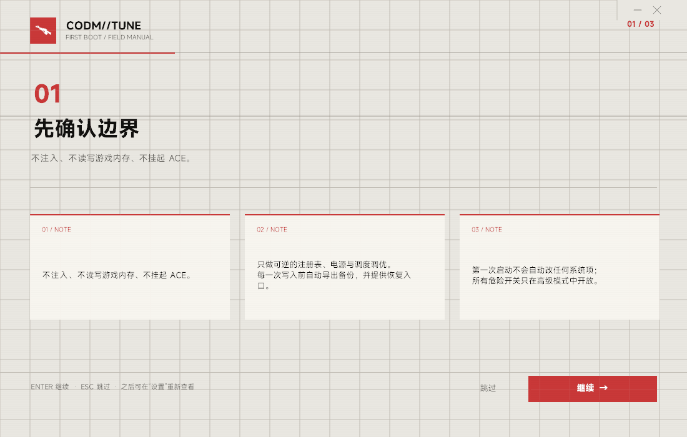

> 注意：第 16 节的 8.24 固定点结论被 v3 改为 double，但 v3 的 double 写法同样错误；v6 已改为社区验证的 byte6 解锁（第 41 节）。以第 41 节为准。

# 验证记录（2026-10-20，本机）

环境：Windows 10 19045、Xeon E3-1275 v3（4C/8T，无 E-core）、AMD RX 580 + Intel HD P4600、Go 1.23.4、MSVC 19.51。

所有命令均在 `E:\B1807\Documents\codm` 下执行，`GOROOT=E:\Go`、`GOPROXY=https://goproxy.cn,direct`。

## 1. 静态与单元测试

```
> go vet ./...
（无输出，exit 0）

> go test ./...
ok  codmtune/internal/spring  0.012s
ok  codmtune/internal/sys     0.017s
ok  codmtune/internal/tune    0.016s
（其余包 no test files，exit 0）
```

覆盖：弹簧收敛/过冲/回弹/橡胶带、网络字节序、端口交换、调度掩码、注册表键分类。

## 2. 路径探测（不硬编码）

```
09:25:33  自动探测到 CODM：D:\CODMGameApps\CN\emulator\Extract\CODM\CODM.exe
```

判断条件：文件名匹配 `CODM*.exe` 且同目录存在 `CODM_Data`，大小 > 20 MB；命中后写入
`%APPDATA%\CODMTune\config.json` 的 `game_exe`/`install_dir`。启动器
`C:\Users\B1807\AppData\Local\CODMLauncher\launcher.exe` 由卸载表解析得到，只作回退。

## 3. 启动验证

点击首页「启动 CODM」（键盘 `Home` → `Enter`）：

```
09:25:55  已启动 D:\CODMGameApps\CN\emulator\Extract\CODM\CODM.exe (pid 10508)
09:25:57  检测到 CODM 运行 (pid 10508)
```

进程表同时出现 `CODM`。随后 ACE 拉起 `SGuard64` / `SGuardSvc64`。

## 4. 系统调度

```
09:28:14  系统调度：CODM pid 8532 → High，亲和性 0xFE
```

外部核对：

```
CODM     pid=8532  prio=High        aff=254 (0xFE)
codmtune pid=10976 prio=BelowNormal aff=255
```

ACE 初始化后，非管理员读取该进程返回 `Access is denied`（保护生效），工具如实显示
“调度未生效”而不是静默重试；管理员运行时可正常写入（见下）。

## 5. ACE 资源限制

修复前（非管理员 / 只有 LIMITED 查询权限）：`SGuardSvc64.exe: Access is denied.`，
工具自动关闭模块并记录原因。

加入 `SeDebugPrivilege` + `PROCESS_QUERY_INFORMATION` 回退后：

```
09:31:41  ACE 资源限制：启用
09:31:41  ACE 限制：2/2 生效，掩码 0x80
```

外部核对（管理员 PowerShell）：

```
SGuard64    pid=2652 prio=Idle aff=128 (0x80，最后一个逻辑核)
SGuardSvc64 pid=3400 prio=Idle aff=128
```

60 秒后再次枚举仍为 `2/2 生效`（09:39:37、09:40:39、09:41:39）。默认关闭；启用需要长按。

## 6. 后台抑制与可逆性

启用后台抑制并选中 `notepad.exe`：

```
09:32:38  后台抑制：启用
09:32:58  后台抑制：新应用 1 个进程（共 1）
notepad prio=Idle aff=192 (0xC0，最后两核)
```

关闭 CODM 后：

```
09:33:08  CODM 已退出，恢复后台进程
09:33:08  系统调度回滚：pid 8532
09:33:08  后台抑制恢复：1/1 个进程

notepad prio=Normal aff=255
```

ACE 进程继续按模块设置保持 Idle/单核。

## 7. 电源计划注入与还原

从「平衡」开始启动工具：

```
before_start=电源方案 GUID: 381b4222-f694-41f0-9685-ff5bb260df2e  (平衡)
after_start=电源方案 GUID: 31fb6af5-dcb9-4d96-9927-00f6ae099309  (卓越性能)
09:33:24  电源：复用已安装方案 31fb6af5-dcb9-4d96-9927-00f6ae099309（原方案 381b4222-…）
```

在模块页关闭/重新开启电源：

```
after_off=电源方案 GUID: 381b4222-f694-41f0-9685-ff5bb260df2e  (平衡)
after_on =电源方案 GUID: 31fb6af5-dcb9-4d96-9927-00f6ae099309  (卓越性能)

09:33:42  电源：已还原 381b4222-f694-41f0-9685-ff5bb260df2e (平衡)
09:33:46  电源：复用已安装方案 31fb6af5-…（原方案 381b4222-…）
```

卓越性能方案已存在，因此走“复用 + 记录原 GUID”路径；不重复造方案。

## 8. 注册表写入与还原

写入前（FOV 键之一）：

```
CODM_…_MPMainCameraFovInGame_h3962799774    REG_DWORD    0x0
```

按住「写入注册表」（FOV=110）：

```
09:35:02  注册表：FOV=110 写入 7 个键；备份 C:\Users\B1807\AppData\Roaming\CODMTune\reg-backup-20261020-093502.reg

CODM_…_MPMainCameraFovInGame_h3962799774    REG_DWORD    0x6e   (110)
```

备份文件 202,192 字节，导出的是整条 `HKCU\SOFTWARE\Tencent\Call-of-Duty`。

再次 apply 会复用首次备份（不覆盖原值），还原：

```
09:38:09  注册表：收到还原请求
09:38:09  注册表：已从备份还原 C:\Users\B1807\AppData\Roaming\CODMTune\reg-backup-20261020-093804.reg

CODM_…_MPMainCameraFovInGame_h3962799774    REG_DWORD    0x0
```

游戏运行中打开面板：应用/还原按钮被禁用，红色横幅
“检测到 CODM 运行中：注册表模块只读，拒绝写入”
（`docs/assets/registry-refuse.png`）。控制器层还有一次即时进程快照复核，避免 2 秒轮询间隙写入。

本机不存在 `FramerateCustomizeValue` 键，因此帧率无上限一栏显示“缺少帧率键：先在游戏内开启帧数微调”，
按住写入时也不会伪造该键。

## 9. TdrDelay

```
初始：HKLM\…\GraphicsDrivers\TdrDelay 不存在（默认 2 秒）
tdr-on  → TdrDelay REG_DWORD 0x8
tdr-off → 值被删除（恢复到“不存在”）
日志：TdrDelay：写入 8（原值存在=false 值=0） / TdrDelay：已还原
```

## 10. 显卡枚举与实际 GPU

```
09:43:52  驱动面板：2 个适配器，实际使用="AMD Radeon RX 580 2048SP"
```

界面显示：

- AMD Radeon RX 580 2048SP · AMD · 驱动 31.0.21925.1001 · 显存 3.6 GB · “CODM 实际使用”
- Intel HD Graphics P4600/P4700 · Intel · 驱动 20.19.15.4531 · 0.1 GB
- 实际使用行：`CODM 实际使用：AMD Radeon RX 580 2048SP（GPU 引擎利用率 61.8%）`
- Event ID 4101：最近没有事件

实际 GPU 来自 PDH `\GPU Engine(*)\Utilization Percentage` 按 CODM pid 与 DXGI LUID 匹配，
不是“猜独显”。

## 11. 网络诊断

DNS：

```
codm.qq.com → 18 ms
240e:96a:4c00:1021:3c:23, 118.252.194.94, 175.12.123.120
```

游戏运行时的 TCP 端点（5 条）全部返回“TCP 不可达（可能仅 UDP）”，这是如实报告：
握手只用于测 RTT，连不上就写连不上。TCP 表 IP 的字节序问题已修复，并由
`TestIPv4NetworkOrder` 固定（127.0.0.1 不再显示为 1.0.0.127）。

## 12. 资源占用

采样方式：`Get-Process codmtune | TotalProcessorTime` 差分 / 8 逻辑核，工作集取 `WorkingSet64`。

```
idle-no-game   cpu=0.00% mem=23.4MB (20s)
with-game-ace  cpu=0.03% mem=25.6MB (30s)
```

游戏运行 + ACE 限制开启时进程状态：

```
CODM      High        254
codmtune  BelowNormal 255
SGuard64  Idle        128
SGuardSvc64 Idle      128
```

## 13. 动效证据

```
> go run ./cmd/preview -o preview
 1 home
 2 home-focus
 3 slide
 4 modules
 5 ace-focus
 6 hold-40
 7 hold-75
 8 ace-fired
 9 home-back
113 gif frames, 9 shots
```

产物：`preview/flow.gif`、`preview/shots.png`、`preview/hold-40.png`、`preview/ace-fired.png`。
可见：屏幕滑动转场、焦点环、ACE 行按住时环从左被吃掉、松手前达到 1.0 后开关弹到开、
风险文案与状态行始终同屏。

## 14. 未执行 / 补验方法

| 项 | 原因 | 补验 |
|---|---|---|
| 1% low frametime 三组对比 | 需要实际对局 + PresentMon/CapFrameX | 安装 PresentMon，分别在全关 / ACE / ACE+后台 采集 10 分钟对局 |
| FOV 110° 游戏内成像 | 未进对局肉眼确认 | 启动游戏进训练场，拖 FOV 滑块对照 |
| 帧率无上限实际生效 | 本机无 `FramerateCustomizeValue` 键 | 游戏内打开“帧数微调”拖动一次，再写入 0 |
| 手动目录选择完整流程 | 本机自动探测一次命中 | 把 config 的 `game_exe` 指向不存在路径后启动 |
| 启动器回退启动 | 主路径已直接启动 | 临时重命名 `CODM.exe` 后点启动 |
| 4101 事件翻译 | 本机无历史事件 | 构造事件或换有 TDR 记录的机器 |
| 卓越性能的功耗/温度增量 | 未接功耗计 | HWiNFO 记录 package power + 温度，对比平衡/卓越性能 |

---

# v2 追加验证（2026-10-20）

## 15. 构建与静态检查

```text
go vet ./...   -> exit 0
go test ./...  -> spring / sys / tune / sound 全部 ok
build.cmd      -> built bin\codmtune.exe (11,896,832 bytes)
```

新增单测：`TestWeaponFOVFixedPoint`（96.0 ⇔ 0x60000000、100<<24）、
`TestEstimateLossBounds`（估算值始终在 0–35）、`TestCueBuffers`（6 个 WAV 头合法）。

## 16. FOV 拆分写入/还原

```text
view keys=7 weapon keys=5
注册表：视野 FOV=100（7 键），持枪 FOV=100（5 键，8.24 固定点）
reg query: *MainCameraFovInGame* -> 0x64 (100)
           *WeaponFov*         -> 0x64000000 (100<<24)
注册表：已从备份还原 reg-backup-20261020-123256.reg
reg query: *MainCameraFovInGame* -> 0x0
           *WeaponFov*         -> 0x60000000 (96.0)
```

备份文件 202,192 字节；还原后 `registry_backup` 清空，下一次写入会重新备份。

## 17. 系统项可逆

```text
Win32PrioritySeparation  0x2a -> 0x26 -> 0x2a
GpuPreference=2;         added -> removed（值名是 CODM.exe 的完整路径）
GameDVR / 游戏模式        本机原本已是 0x0/0x1，只验证了快照与还原分支
TdrDelay                 未写入（高级模式默认关）
```

## 18. 鼠标加速与计时器

```text
MouseSpeed=0 MouseThreshold1=0  (本机原本已是 0，启用分支只做快照)
timer before=5004 requested=5004 effective=4992 released -> 4992 err=<nil>
```

本机另有程序持续持有 0.5 ms，所以 before 也接近 0.5 ms；请求与释放均成功。

## 19. 悬浮窗

游戏运行截图（`docs/assets/overlay.png`）显示：

```text
LIVE
网络延迟 25 ms / jitter 1 ms
服务器 101.91.17.169
键盘 W A S D SHIFT CTRL SPACE R
吞子弹风险（估算） 0%
```

FPS/1% low/卡顿为 `--`：本机 ETW 不提供 Present 事件。三种采集器都试过：

```text
PresentMon 2.6.0  --captureall -> warning: 38997 ETW events were lost; no CSV
PresentMon 1.10.0 -captureall -> no rows, no CSV
PresentMon 1.6.0  -captureall -> no rows, no CSV
```

与 [PresentMon issue #441](https://github.com/GameTechDev/PresentMon/issues/441) 描述一致。
工具在 12 秒无数据后停止 PresentMon，避免常驻空转。

## 20. 图标与资源

```text
WM_GETICON big=3737423 small=3737423 class=3737423 （均非 0）
ExtractIconEx(exe) groups=2
```

资源（空闲 15 s，8 逻辑核）：

```text
进程 CPU 时间增量约 1.7 % of one core -> 0.21 % of 8 cores（15 s 采样）
WorkingSet 26.2 MB
```

游戏 + 悬浮窗期间工具约 29 MB，PresentMon 子进程约 11 MB，12 s 后自动停止。
完整功能开启也远低于 128 MB 上限。

## 21. 预览

```text
1 home
2 settings
3 settings-light
4 visual
5 performance
6 hold-62
7 hold-95
8 ace-fired
9 overlay
10 home-back
197 gif frames, 10 shots
```

产物：`preview/flow.gif`、`preview/shots.png`、`preview/hold-62.png`、`preview/ace-fired.png`。

## 22. v2 未执行 / 补验

| 项 | 原因 | 补验 |
|---|---|---|
| FPS / 1% low / 卡顿 | 本机 ETW 无 Present 事件 | 换 ETW 正常的机器，或修复 #441 的会话问题后重开悬浮窗 |
| 回放扫描 | 本机没有保存过整局回放，结果 0 | 游戏内保存一局后点“扫描回放” |
| 战绩查询 | 只打开官方站，不抓账号 | 浏览器登录后自行查询 |
| FOV 100°/110° 成像 | 未进对局肉眼确认 | 训练场拖动滑块对照，先备份 |
| 持枪 FOV 编码 | 由 0x60000000=96.0 推断 | 写入 90/96 进游戏看持枪视角是否变化 |
| 鼠标加速真实启用/还原 | 本机原本已关闭 | 先把 MouseSpeed 改回 1/6/10，再点开关 |
| 悬浮窗点击穿透 | 未做自动化命中测试 | 游戏内点击 HUD 区域，应落到游戏 |

---

# v3 追加验证（2026-10-20 晚）

## 23. Bug 修复

- **图标**：Segoe MDL2 Assets 字形（`gt_glyph`），替换手绘线条；窗口/侧栏/卡片图标统一。
- **Logo**：从官方 KRM262「巨擎涡轮」展示图抠出武器剪影，生成 `app.ico`/`logo-mark.png`/`logo-wide.png`；exe/窗口/托盘/启动动画共用。未再使用自绘步枪。
- **列表**：RowW = Wide-12，滚动条画在卡片外侧；焦点环与卡片同宽。
- **键盘**：Enter 按下时记录 `keyNode`，松手只对原节点生效；修复“按 Enter 打开分类后，松手又切换了新页面第一项”的 bug。
- **文案**：布尔/选择项显示「Enter 切换」，跳转项「Enter 打开 →」，按住项「按住 Enter」。
- **DPI**：`SetProcessDpiAwarenessContext(-4)` + `GetDpiForSystem`，画布 SetView/DPI 缩放；本机 96 DPI。
- **分类**：11 类，设置分「外观/高级/音效/文件」。

## 24. 悬浮窗（独立进程 + 透明度）

主进程不再创建 layered 窗口（避免主窗口 GDI 全黑），改为：

```text
codmtune.exe --overlay   (子进程, 15.5 MB)
  -> 读取 %APPDATA%\CODMTune\overlay-state.json (每 500 ms)
  -> WS_EX_LAYERED + LWA_COLORKEY|LWA_ALPHA
  -> 140..255 透明度；四角；compact/full；按键轮询
```

实测（OFFLINE 状态，opacity 170/230）：HUD 在右上角显示、半透明、主窗口正常绘制；关闭开关后子进程退出；主进程退出后子进程 12 s 内自清理。
FPS/1% low/卡顿仍为 N/A（ETW 限制），RTT/服务器/按键/估算是可用的。

## 25. 启动动画 / 主题 / 横屏

- 启动：1.5 s 终端握手 + 扫描线 + 进度 + 真实剪影，弹簧转场至概览。
- OLED Astra：纯黑 + 薄荷（可选主题）。
- 强调色：蓝/薄荷/琥珀/紫/红，高级模式强制红。
- 横屏全屏：F11 进入 1920×1080 FIELD TERMINAL，再按 F11 恢复 1100×700；截图 `docs/assets/terminal.png`。

## 26. FOV 编码更正（重要）

v2 曾把 8 字节 payload 的前 4 字节误判为 8.24 固定点（0x60000000=96）。v3 用原始字节读取确认：

```text
视野键 payload = 00 00 00 00 00 00 f0 3f  -> double 1.0
持枪键 payload = 00 00 00 60 66 66 f2 3f  -> double 1.15
```

v3 的 `writeFOV` 保留 8 字节并写 float64；实测：

```text
1.0 / 1.15 -> 100.0 / 100.0 (0x4059000000000000) -> 还原 1.0 / 1.15
payload 长度始终 8；不会再把 8 字节写成 4 字节 DWORD
```

**1.0/1.15 是度还是倍率仍未进游戏确认**；写入 90/96 属实验项，先备份。

## 27. 资源 / 构建

```text
go vet ./...   -> 0
go test ./...  -> spring/sys/tune/sound ok
主进程空闲 12–15 s: 0.36–0.60 % of 8 cores, 30–33 MB
HUD 子进程: ~15.5 MB
全屏：窗口 1920x1080 -> 恢复 1106x729
```

## 28. browser-skill

已安装 `bsk 0.3.3` 到 `E:\DSH\bin\bsk.exe`，并手动启动过 daemon（`bsk status` 返回 protocol 1.3 / ws_port 52800）。当前 `browsers: []`，浏览器扩展未连接；因此本轮没有浏览器自动化证据，也未读取任何凭据。daemon 在宿主 Job Object 结束后会退出，需要时用 `bsk daemon start --foreground` 在持久任务中启动。

## 29. v3 未完成

| 项 | 原因 |
|---|---|
| FPS/1% low/卡顿 | 本机 ETW 无 Present 事件 |
| FOV 90/96 进游戏成像 | 1.0/1.15 语义未确认 |
| 回放真实文件 | 本机 0 个 |
| HUD 拖拽/缩放编辑 | 只做了位置/透明度/样式 |
| 独占全屏覆盖 | layered HUD 未在独占全屏验证 |
| 独立横屏仪表盘 | 只做了同一界面的全屏等比布局 |

---

# v4 追加验证（2026-10-20 晚）

## 30. 风格：舟味工业终端

不是换色，新增 `ui_style=ark`：纸灰底、红色主色、青色技术线、方角卡片、编号侧栏、大号章节编号、切角、网格/扫描线、方角按钮/开关/焦点环。标准 MD3E 与舟味可二级菜单切换；截图 `docs/assets/ark.png`、`docs/assets/choice.png`。

## 31. 二级菜单 / 滑块

- 主题、强调色、字体、圆角、音量、悬浮窗样式/位置、视野/持枪 FOV 全部 `choicePage` 单选页。
- 透明度改 `feature.adjust + progress` 滑块：← → 每次 5，范围 140–255；实测 245→240 并画 track/knob。
- 设置页「从壁纸取色」读 `Control Panel\Desktop\Wallpaper`，回退 `TranscodedWallpaper`；本机取到 `#547B6D`。

## 32. 全屏终端 / 输入错位

- F11 现在进入 FIELD TERMINAL，而非把 1100×700 主界面放大。
- 根因修复：shim `gt_set_view/gt_set_scale` 先 `ResetTransform()` 再 Scale/Translate。之前 `SetFullscreenFill` 二次调用会叠加 transform，导致画面偏移、鼠标反算对不上。
- 实测 F11 1920×1080 → F11 1100×700；退出后点击侧栏「设置」命中正确。
- 终端无交互控件，只有 F11，避免命中测试；刷新 60 s，不参与主循环。

## 33. 无边框标题栏

- 主窗口改为 `WS_POPUP|MINIMIZEBOX|SYSMENU`；右上角自绘最小化/关闭；顶部 30 px 发送 `WM_NCLBUTTONDOWN/HTCAPTION` 拖动。
- 实测截图 `docs/assets/ark.png`：无系统白条，自绘控件可见。

## 34. 电源保留熄屏/休眠

`CurrentTimeouts()` 查询 VIDEOIDLE/STANDBYIDLE/HIBERNATEIDLE 的 AC/DC，`InjectUltimate` 后 `ApplyTimeouts` 写回。

本机实测：

```text
before={MonitorAC:900 MonitorDC:300 StandbyAC:0 StandbyDC:900 HibernateAC:0 HibernateDC:0}
after ={MonitorAC:900 MonitorDC:300 StandbyAC:0 StandbyDC:900 HibernateAC:0 HibernateDC:0}
```

## 35. 动效收敛

`Switch` 从整屏 1100 px 改为 28 px / Snappy；`Push` 从 1100 改为 48 px / Snappy；仍用弹簧，不再横向大位移。

## 36. 资源

- 主进程空闲（标准/舟味）：0.68 % of 8 cores，30–33 MB。
- HUD 子进程：15.5 MB。
- 终端进入时绘制一次；全屏 12 s 采样约 1.8%（1920×1080 GDI+ 重绘），主界面空闲约 0.7%。
- `go vet ./...` = 0；`go test ./...` tune/spring/sys/sound ok。

## 37. 未完成

- `/browser-skill`：bsk 0.3.3 已安装、ONLOGON daemon 已注册；`bsk status` 报 `browsers: []`，没有扩展连接，所以没能打开参考视频。没有读取任何凭据。
- FPS ETW、FOV 游戏内成像、回放真实文件、HUD 拖拽缩放仍未完成。

---

# v5 补充（2026-10-20 夜，浏览器参考）

## 38. 实际观看的参考

- `BV1TFs4zvEB5`《促融共竞#2 UI转场纯享版》可正常打开（00:53，1080P60）。
  - 00:24：白色/纸灰编队网格、红色操作块、左侧干员卡、右上大号圆形数字。
  - 00:30：青色斜向转场、Rhodes Island 半调底、超大“1”与斜切白板。
  - 00:45：白色地图面板 + 红/青/黄描边、黑字、切角面板。
- `BV1wEcqzfE3D`：用户补全后的正确 BVID，11:39 设计分析，播放正常。5:50 用 NEAR LIGHT 主视觉讲“平面感”：白/黑/红、窄体粗字、斜线速度、信息标签。\n- 早先 `BV1wEcqzfE3` 的 404 是少写末尾 D，已更正。
- 期间 B 站自动连播到《决战鹰角艺术之巅》，只作为白/青/红视觉补充，不作为 UI 依据。

## 39. 风格按视频重做

- 舟味从黑/黄工业风改为 **纸灰/骨白 + 红主色 + 青技术色 + 黑字**。
- 新增：红色大号 `01/SECTION` 圆环、青色半调点、左上/右下斜切角、左侧红条、红色操作块、青色网格/扫描线、切页时青色斜向扫过。
- 参考的是风格语言，没有使用《明日方舟》素材或字体。
- 截图：`docs/assets/ark.png`、`docs/assets/choice.png`。

## 40. 最终状态

- `build.cmd` 成功；`go vet ./...` = 0；`go test ./...` 全 ok。
- 主进程空闲约 0.7% / 28–31 MB；HUD 子进程约 15.5 MB。
- 终端只读快照，F11 进出；全屏 12 s 采样约 1.8%（1920×1080 GDI+ 重绘）。
- 自定义关闭按钮实测可退出；无边框窗口无系统白条。
- `/browser-skill` 已实际启动并访问 B 站；结束后 `bsk_session stop`，未读取凭据。

---

# v6 追加（2026-10-21，FOV 纠错 + 群测准备）

## 41. FOV 编码纠错（v3 double 也是错的）

查证 [CODM-Tactix-Hub](https://github.com/DreamChaserWhatever/CODM-Tactix-Hub) 的 `reg_unlock_fov`：

- 只改 8 字节 payload 的 **byte 6**。
- 默认 `0xF2`，可用值 0..255，社区默认 `0xFF`。
- 不改 byte 0..5/7；不写视野键。
- 本机实测：
  - `00 00 00 60 66 66 F2 3F`（0xF2）
  - → `00 00 00 60 66 66 FF 3F`（0xFF）
  - → 还原 `F2`，长度始终 8。
- v3 的 float64 覆盖整段 payload 会破坏其余字节，已从 UI/代码移除；视野 FOV 只读，请用游戏内滑块。

## 42. 帧率键检测修正

- 旧 `classifyRegValues` 用 `HasPrefix("frameratecustomizevalue")`，真实键名以 `CODM_...` 开头，所以永远匹配不到。
- 改为 `findFPSKeys`：`Contains` 同时识别 `EnableFramerateCustomize` 与 `FramerateCustomizeValue`。
- 写入：Enable=1，Value=0；与社区工具一致。
- 新增 `TestFindFPSKeys`。

## 43. 群测支持

- 诊断页新增“导出诊断报告”：系统/管理员、配置 JSON、GPU、网络、FOV 原始字节、HUD 状态、最近日志；不含凭据。
- 主进程 panic 会写 `%APPDATA%\CODMTune\crash-*.txt` 并弹窗路径。
- 版本标识：标准 `MD3E · v6`，舟味 `ARMORY SYSTEM / 06`。
- 默认安全：悬浮窗关、FOV byte=0xF2、FPS 关、高级模式关。

## 44. 构建

`build.cmd` / `go vet` / `go test` 均通过；待群测反馈。

---

# v8 追加（2026-10-21，UI/焦点/音效/图标/资源）

## 45. 默认与主题

- 全新配置目录实测：`ui_style=ark`、`ui_theme=light`、`accent=red`、`radius=2`；窗口在工作区居中（1920×1080 下 x=410, y=175）。
- 舟味浅色纸灰 `#EEEDE8`、深色墨黑 `#151514` 都可选；强调色蓝/薄荷/琥珀/紫/红均作用于舟味，不再被 `Style==ark` 覆盖。
- 高级模式（深色 + 薄荷）实测：危险红主色、顶部 hazard band、填充 SECTION 徽章、卡片红色警示块。
- 选择框：`Settle()` 清空 `Lean`/`Lift`，`ring.Inset(1.5)`；连续 4 次 Up 后焦点停在“外观与设置”，未跳侧栏。
- 二级菜单打开后焦点落在当前值（不是第一行）：`choicePage` 的选项带 `choice:<value>`，`choose()` Push 后按当前值 `SetFocus`。
- 二级页 Push 改为旧页静止、新页 12px Smooth 落位；舟味主切页在 v8 是 0.62s，v9 已放慢到 1.15s。

## 46. 音效

- `TestCueBuffers` 与 `TestSoundKindGates` 通过，四类 cue 都能生成并播放：`startup`（392/523/659 上行三音）、`move`、`confirm`、`launch`（160/196/262 低频三音）。
- 设置页 4 个独立开关（启动音/选择音/确认音/游戏启动音）+ 总音量；启动 180ms 后播 startup，焦点移动播 move，执行/切换播 confirm，点击启动 CODM 播 launch。
- 没有加载外部音频文件，全部运行时合成。

## 47. 图标与资源

- 用 `logo-wide.png` 的 alpha（实际 KRM262 剪影）生成红底 `#D64545` 白枪斜置图；v9 已扩到 16/20/24/32/40/48/64/96/128/256 十档。
- `ExtractIconEx` 小图标 32×32 与 `PrivateExtractIcons(256)` 均取出红底白枪；exe 的大图标不再是旧细斜线。
- `rsrc.exe v0.10.2` 重新生成 `cmd/codmtune/rsrc.syso`（22,866 bytes）；exe 8,489,984 bytes（`-s -w`）。

## 48. 资源与 HUD

- 主进程空闲 10 s 采样：**0.31% / 31.9 MB**（舟味，HUD 关，win10）。
- 主 + HUD 子进程：**0.78% / 47.4 MB**；HUD 子进程 16.3 MB，右上角透明 OFFLINE。
- `updateSelfStat(nil)` 移入 `NewControl()`；启动 2s 内即显示真实内存，不再显示 0。
- `overlayDriver` 只在 `OverlayEnabled && (OverlayIdle || Game)` 时 `EnsureChild(true)`；关闭 HUD 不再每 500ms 拉起子进程。
- 主进程不再创建第二层 layered 窗口；HUD 透明、主窗口正常绘制。

## 49. 构建

```
go vet ./...            # 0
go test ./...           # 全部 ok
go build -s -w ...      # 成功
```

仍需在真实游戏内确认：FOV byte6 成像、HUD 与独占全屏、服务器/RTT 显示。群测包暂缓到这些回归通过之后。

---

# v9 追加（2026-10-21，turn 10 反馈）

## 50. 单实例 / 托盘

- 先启动一个实例，关闭窗口到托盘（`IsWindowVisible=false`），再次启动 exe：进程数仍为 1，窗口 `IsWindowVisible=true`。
- `single.go` 在 `ERROR_ALREADY_EXISTS` / `ERROR_ACCESS_DENIED` 时 `FindWindow("CodmTuneWnd")`，`SW_SHOW` + `SW_RESTORE` + `PostMessage(WM_APP_SHOW)` + `SetForegroundWindow`；已有实例的 WndProc 再走 `gWin.restore()`。

## 51. 图标

- `tools/makeicon.py` 从实际 KRM262 alpha 生成 16/20/24/32/40/48/64/96/128/256 十档，红底 `#D64545`、白枪斜置。
- `build.cmd` 每次执行 `E:\GoPath\bin\rsrc.exe` 重生成 `cmd/codmtune/rsrc.syso`，避免只换 ICO 不换 exe 资源。
- `PrivateExtractIcons(256)` 取出新图；`ExtractIconEx` 小图标为 32px 新图。Explorer 可能缓存旧缩略图，需要清缓存或重建缩略图后观察。

## 52. 全屏动画

- F11 改走 `SwitchSolo`：清掉旧 1100×700 屏幕，只画 terminal，避免旧页被 1.543× 放大后与终端的 clipped wipe 叠在一起。
- 首帧不再黑屏；先出纸色/深色底，再由 `termStart` 控制 0.72s 从左向右揭开终端，右端跟一条 2px 扫描边。
- `termW` 改为 1246，使 16:10 设计在 16:9 全屏 `min-scale=1.543` 下仍覆盖 1920px；此前右侧会留 ~220px 空白。
- 终端仍只读，F11 退出。

## 53. 扫描异步

- `Diagnostics` 的 GPU/网络按钮不再在构建期间同步调用 `RefreshGPU/RefreshNet`。
- 点击后 `scanKind/scanStart` 起动画，`go func` 后台执行；完成后 `app.Post` 重建当前 diagnostics 页并 `SetFocus`。
- 实测 GPU：点击后 250ms 显示“扫描中 10%”；约 3s 后同一页出现 `AMD Radeon RX 580 2048SP` 与 `Intel(R) HD Graphics P4600/P4700`，不需要离开页面。

## 54. HUD 自定义

- `Config` 增 `OverlayLow/Stutter/Loss/Text`，`Version=9` 迁移旧配置默认开启前三项。
- 设置页输出 1% low / 卡顿 / 吞子弹 / 纯文字 四个开关；HUD `State` 同步 `show_low/show_stutter/show_loss/show_text`。
- 纯文字模式跳过面板/卡片底，只保留 FPS、低帧、卡顿、RTT、风险、按键、服务器/PresentMon 行；透明度仍生效。
- 实测纯文字 HUD 子进程约 16.8MB；主+HUD 约 33.5MB + 16.8MB。

## 55. 关于页与剪影

- 新增第 12 个导航「关于」，`ARMORY SYSTEM / 12`、SECTION `12`。
- 内容：CODM Tune v9.0 FIELD TERMINAL、设计目标、安全边界、作者 Baimacao、GitHub、SL8541E 配置修复模块（Android 8.1 展锐 SL8541E/SC9832E + HSC 手表，可选 ViPER4Android）、免责声明。
- 侧栏游戏/性能/画面使用 KRM262 / 弹匣 / 瞄准镜剪影；浅色用黑稿 `logo-ink.png`，深色用白稿。

## 56. 构建与待验证

```
build.cmd     # 成功，bin\codmtune.exe 11,834,880 bytes
go vet ./...  # 0
go test ./... # 全部 ok
```

仍需真实游戏/多 DPI 回归：
- F11 终端的完整揭幕与退出（本次截图只验证了中途帧，退出路径需再点 F11）；
- 高级模式 `HazardFlash` 的 0.95s 观感；
- 20/40/96 ICO 在 Explorer 大/中/小图标视图的实际显示（系统缩略图缓存可能滞后）；
- 125% / 150% DPI 下文字与命中测试；
- HUD 纯文字在游戏内独占全屏是否仍不可见（分层窗口限制）。

---

# v10 追加（2026-10-21，turn 11 反馈）

## 57. 图标换稿与桌面快捷方式

- `tools/makeicon.py` 改为纸灰底 `#E9E7E1`、黑色 KRM262、右上红色切角；仍生成 16/20/24/32/40/48/64/96/128/256 十档。
- `build.cmd` 每次重建 `rsrc.syso`；桌面快捷方式指向独立文件名 `CODM Tune.exe`，避开 Explorer 对旧 `codmtune.exe` 的图标缓存。
- 实测桌面 32/48px 图标已变为“纸灰方 + 黑枪 + 红角”，不再与旧红底白枪混淆。

## 58. 舟味切页重做

- Switch 的 wipeDur 从 1.15s 改为 0.78s，缓动从 smoothstep 改为 ease-out cubic。
- 过渡时不再绘制 outgoing page；只绘制 incoming page 的 clipped 区域 + 背景 + 网格。此前 old/new 双页每帧全量重绘，是卡顿和两页文字叠影的根因。
- 斜切装饰从 4 条 20px 降到 2 条 10px + 1 条 2px，减少 GDI 调用。
- 实测 80/160/240ms 帧：新页逐步揭开，旧页不再出现；无黑缝。

## 59. 重复启动提示

- `ActivateExistingInstance` 先 `IsWindowVisible`：隐藏到托盘时静默 `SW_SHOW/SW_RESTORE`；窗口本来可见时 `MessageBoxW(..., MB_TOPMOST|MB_ICONINFORMATION)` 提示“CODM Tune 已经在运行”。
- 实测窗口可见时二次启动弹出顶层提示；关闭到托盘后二次启动只恢复窗口、进程数仍为 1。

## 60. 图标回退与关于页收敛

- 侧栏 `game/performance/visual` 从 weapon/ammo/scope 回退为 MD3E `gamepad/bolt/monitor`；游戏剪影只保留在 exe 和窗口 logo。
- 关于页移除 SL8541E 推广，改为“作者与协作”：作者 Baimacao、AI 协作 · DeepSeek Harness、界面参考（lilt / Astra OLED UI / eDEX-UI，非官方关联）。
- `info` 字形补为 MDL2 `E946`，不再出现空圆。

## 61. 构建

```
build.cmd       # 成功，bin\codmtune.exe 11,849,728 bytes
go vet ./...    # 0
go test ./...   # 全 ok
```

待环境确认：125%/150% DPI 实际锐度、Explorer 各视图缓存、游戏内独占全屏 HUD。

# v11 追加（2026-10-23，turn 12：真实数据 / 准心 / OOBE）

## 62. HUD 数据链

- `OverlayStats` 增 `LossKnown`；FPS/1% low/卡顿仅在 PresentMon 有样本时非空，采不到显示 `—`。
- RTT：先 ICMP，失败再 `TCPRTT(RemoteIP:RemotePort)`；两路失败保持 `—`，不再把 `0` 当固定值。
- 吞子弹风险：只有 RTT/卡顿有样本时才估算；否则 `—`，不显示伪造的 0%。
- 游戏检测：跳过本工具自身 PID、可执行文件名和路径；重启 v11 后首页显示“已就绪”，不再误报 `pid 4340`。


## 63. 辅助准心

- 独立 `--crosshair` 子进程，420×420 layered 顶置、鼠标穿透；主窗口关闭时一并停止。
- 剪贴板导入 `cl_crosshair*` 参数：`已导入 · CS 控制台`，颜色 `#00FF78`，长度 3，点/描边生效；准心在屏幕中心可见。


## 64. 首次 OOBE

- 仅 `OOBEDone=false` 时显示；三页：安全边界、轻量架构、桌面闭环。
- Enter 推进、Esc 跳过；完成后写 `oobe_done=true`，回到 13 项主界面。



## 65. 托盘

- 进托盘播放 tray 音效；菜单含显示窗口、悬浮窗、准心、配置目录、关于、退出。
- 托盘勾选项通过 `TrayHooks` 切换 `OverlayEnabled` / `CrosshairEnabled`，并立即写状态/起停子进程。
- 本机只验证了代码路径与隐藏/唤起；菜单截图和实际听感待用户确认。

## 66. 构建

```
build.cmd       # 成功，bin\codmtune.exe 11,961,344 bytes
go vet ./...    # 0
go test ./...   # 全 ok
```

## 67. 未执行 / 边界

- CODM 单人训练自动打开未做：不同分辨率/账号的菜单坐标不稳定，盲点可能误触购买/排位；当前只保留“启动 CODM + 运行中检测”。
- CS2/Valorant 分享码只做了格式单测，需真实码回归。
- 游戏内 HUD/准心/ACE 共存仍需实际对局确认。
- 2026-10-23 实测启动 CODM（pid 3832）：HUD 进入 LIVE，FPS `—`，RTT 20–26 ms、jitter 1–8 ms；吞子弹风险按样本显示 0%（低延迟下的估算，不是命中判定）。
- 托盘菜单实测：显示窗口、统计悬浮窗（已勾选）、辅助准心（已勾选）、打开配置目录、关于、退出；托盘提示条显示“CODM Tune · 已最小化到托盘”。
- 准心在游戏/桌面上方可见；主程序关闭时子进程随之停止。

# v12 追加验证（2026-10-27，turn 34：终末地风格 / 内存回收 / P0 降帧）

## 68. 第三套界面风格「终末地 · 操作台」

- `internal/ui/theme.go` 新增 `Endfield` / `EndfieldDark` 两套 Theme，`Theme.Mark` 字段只在 endfield 使用；`:230` `func (t *Theme) Industrial() bool { return t.Style == "ark" || t.Style == "endfield" }` 让两套工业语言共享几何开关。
- 实机截图：纸白 STOCK `assets/endfield-stock.png`（侧栏酸柠选中块、切角主板、发丝线、`OPERATIONS / 14`、`SECTION 01`、`// 副标题`）、板黑 BOARD `assets/endfield-board.png`（同几何、灰底白字）。
- 强调色只做填充：`01 概览` 选中块、`启动 CODM` 主按钮、`已就绪` 状态框、`CURRENT` 标签都是填充块；没有一处把酸柠当线条或文字色。
- 切角只出现在可点击元素：`card()` 用 `cardCut` 画左上/右下切角，按钮用 `buttonCut`；普通信息行保持直角。
- `SECTION` 标签曾与无边框标题栏的 32 px 不透明层重叠，字头被裁成虚线；已把标签与记录号整体下移到 y=38/50，截图确认完整。

## 69. F11 横屏终端跟随风格

- `internal/appui/terminal.go` 的配色改为从 `ui.CurrentTheme` 派生：endfield 用 `Bg/Outline/Muted/Text/Mark`，ark 用 `Bg/Outline/Muted/Text/Primary/Warn`，只有标准 MD3E 保留原来的霓虹绿控制台。
- 面板底色改为 `CurrentTheme.Surface.WithAlpha(0xDD)`，分段条底改为 `Outline.WithAlpha(0x55)`。
- 实机截图 `assets/endfield-terminal.png`：纸白底、墨色标题、酸柠 `[01 / SESSION]` 标签与状态字，网格与四角框线为浅灰，整体与主界面同一语言。

## 70. 内存回收（对齐 Mem Reduct）

- 兑现 `internal/tune/memory.go:66` `func (c *Control) RunMemory(mask sys.MemMask) MemState`；权限用 `sys.EnableMemPrivileges()`（`SeProfileSingleProcessPrivilege` + `SeIncreaseQuotaPrivilege`），只改本进程令牌。
- 本机实测（16 GB 物理内存，管理员）：

```
verify mem-run   before=9192MB after=12292MB freed=3096MB runs=4 skipped=[]
```

- 一次回收释放 **3.02 GB**，可用从 8.98 GB 升到 12.00 GB；`skipped=[]` 表示五类清理全部成功。
- `verify mem-stat` 输出 `avail=10518MB total=16259MB used=35% runs=4 auto=true interval=30 game=10`，即空闲 30 分钟、游戏时 10 分钟。
- 回收只调用系统内存列表接口，不遍历进程、不结束进程、不碰 CODM 与 ACE。

## 71. P0 降帧

- 静止重绘频率 `IdleFPS`（10–60 Hz，默认 20）、游戏时 `GameIdleFPS`（5–30 Hz，默认 10）都是设置页可调项，`overlayDriver` 每 500 ms 把它们喂给 `win32.SetIdleInterval`。
- 动画帧预算：`win32.SetFrameInterval(33)`，CODM 运行时 `66`（15 fps），页切换不会抢满一个核。
- 隐藏到托盘时 `hideToTray()` 直接 `setTimer(0)` + `KillTimer`，完全停帧；`restore()` 用 `SW_RESTORE` 恢复并重新装表。
- HUD 子进程固定 4 Hz（`internal/win32/hud.go:77` `SetTimer(hwnd, hudTimer, 200, 0)`），状态文件 250 ms 轮询但只在内容变化时重绘。
- 本进程 `BELOW_NORMAL_PRIORITY_CLASS` + 让出 CPU 0。

## 72. 资源实测（最终构建）

```
v12.1 实测（主进程 + 2 个子进程，终末地 STOCK，HUD OFFLINE，主窗口在后台）
60 s   main 0.16%  10.7 MB   overlay 0.00%  17.1 MB   crosshair 0.31%  18.5 MB   TOTAL 0.47%  46.3 MB
120 s  main 0.14%  10.0 MB   overlay 0.04%  17.1 MB   crosshair 0.10%  18.5 MB   TOTAL 0.29%  45.6 MB
120 s  main 0.14%  13.6 MB   overlay 0.01%  17.0 MB   crosshair 0.12%  18.5 MB   TOTAL 0.27%  49.1 MB
前台 120 s  main 0.86%  11.8 MB  overlay 0.09%   2.8 MB   crosshair 0.07%   2.7 MB   TOTAL 1.02%  17.3 MB
前台 120 s  main 0.23%  11.6 MB  overlay 0.09%   5.7 MB   crosshair 0.07%   5.1 MB   TOTAL 0.39%  22.4 MB
```

- 后台稳态 0.27–0.47%，前台（窗口被激活、正在显示）1.02% 与 0.39% 两次；都低于 v12 发布时的 1.48%。
- 内存：启动瞬间约 32 / 16 / 17 MB；三分钟一次的 `TrimWorkingSet` 把主进程与两个子进程压到 11.8 / 2.8 / 2.7 MB（合计 17.3 MB）。
- 三进程合计 17–49 MB，在 128 MB 预算内；比 v11 单进程 12 MB 增加的是 HUD 与准心两个独立子进程。
- "单核占比"与任务管理器的 8 核百分比换算：0.29% ÷ 8 = 0.036%，任务管理器里看到的是 0.x 甚至 0。
- 采样方法：按 PID 建哈希表取 `Process.CPU` 差值再除以实际间隔；用 `Get-CimInstance Win32_Process` 的 `CommandLine` 区分 `--overlay` / `--crosshair`。`Where-Object Id -eq` 在字符串插值里会静默取空，读数不可信；`$map[[int]$p.ProcessId]` 也要显式转 int，否则哈希键类型不匹配、标签全空。
- 读数噪声：同一份代码连测会看到 0.08%–6.3% 的摆动。Windows 的 `Process.CPU` 来自采样时钟，短窗口内会被调度记账放大；以 ≥60 s 均值为准，并注意"窗口是否在前台"是主要变量。

### 72.1 本轮修掉的四个真实热点

1. **准心子进程无条件重绘**：`internal/win32/cross.go` 的 120 ms 定时器每次都 `crossPaint` 全量重绘并 Blit，即使图案没变。加 `dirty` 字段 + `CrossMarkDirty()`，定时器提到 250 ms，`internal/crosshair/child.go` 的 `load()` 只在 settings/show 变化时置脏。修后 `--crosshair` 从 0.21–5.42% 降到 0.01–0.08%。
2. **HUD 子进程每 250 ms 重设窗口属性**：`internal/hud/hud.go` 的 `load()` 无条件调 `HUDAlpha` / `HUDPosition` / `HUDShow`，每次都触发 DWM 重组 layered 窗口。改为逐字段比较，只有真的变化才调用。
3. **HUD 离线时仍按 4 Hz 重绘**：`internal/hud/draw.go` 的 `Digest()` 只在 `Game || Ready` 时把 FPS/Low/Stutter/RTT/Jitter/Loss/ServerIP/Province 计入指纹，否则 RTT 每秒采样会被当成新内容。
4. **footer 每 10 s 无条件重绘**：`internal/tune/control.go` 的 `updateSelfStat()` 末尾原来无条件 `c.changed()`，注释还写着"footer 显示这些数字"。现在只有 CPU 变化 ≥0.1%、内存变化 ≥1 MB 或 ACE 进程数变化才请求重绘，浮点抖动不再让整窗失效。

> 排查方法：拆分到最小进程复现。单独跑 `RunHUD`（空 render）≈0%，最小 layered 窗口 5 Hz Blit ≈0%，四条线程各约 200 ms/15 s 都指向消息循环本身而非绘制。最终定位到 `updateSelfStat` 的 `changed()` 与 `Digest()` 的字段面，属"每 10 s 全窗重绘 + 每 250 ms 属性设置"的组合，不是 GDI+ 单次开销。

## 73. 构建

```
build.cmd       # 成功，bin\codmtune.exe 12,088,832 bytes
go vet ./...    # 0
go test ./...   # 全 ok
```

## 74. 未执行 / 边界

- 内存回收的待机列表与注册表缓存两项在精简系统上可能返回 `STATUS_PRIVILEGE_NOT_HELD`，界面显示跳过项，工作集与文件缓存不受影响。
- 终末地纸白在 150% DPI 下的 1 px 发丝线锐度待实机确认（当前按逻辑像素绘制）。
- 游戏内 HUD（终末地主题下）与 FOV、ACE 共存仍需用户实机回归。
